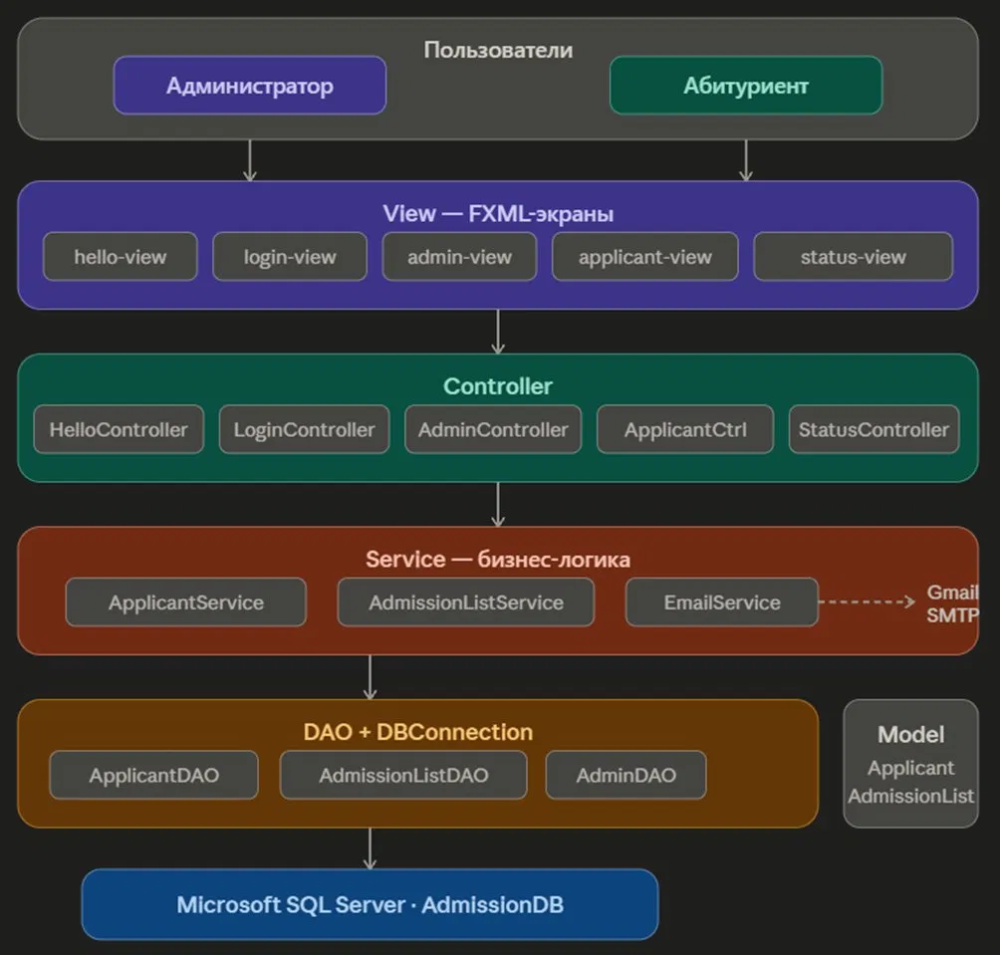
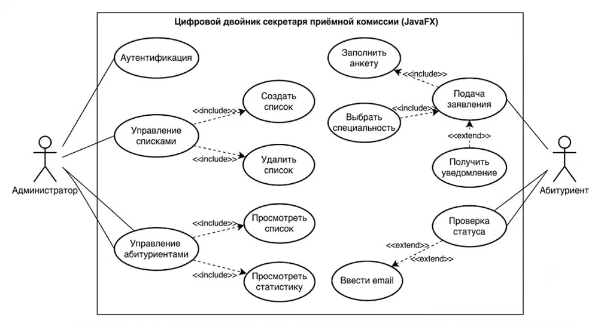
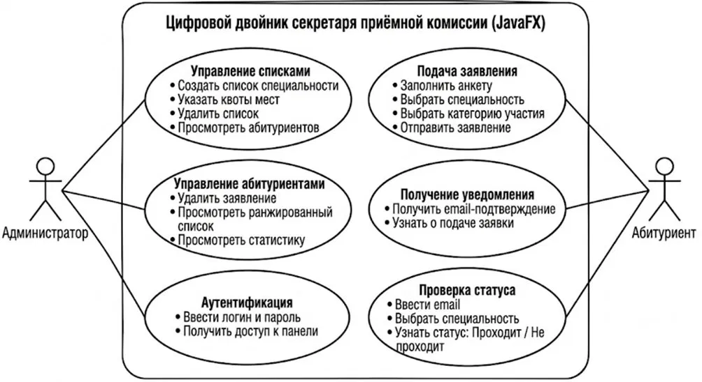
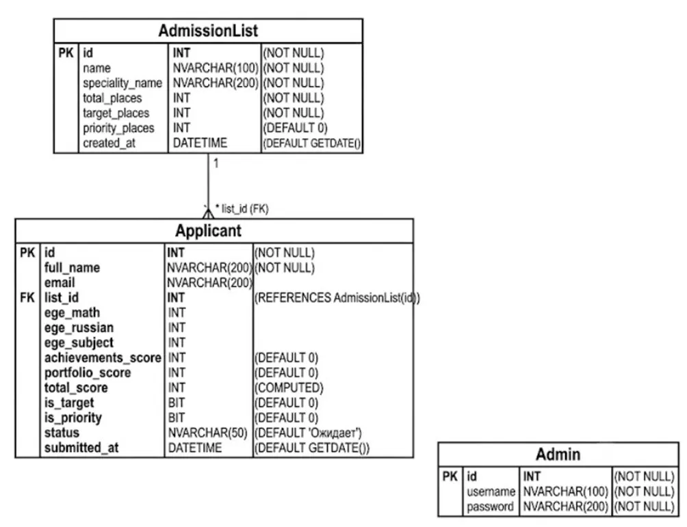

# Цифровой двойник секретаря приёмной комиссии

Десктопное приложение на JavaFX для автоматизации работы приёмной комиссии вуза.
 
---

## О проекте

Приложение автоматизирует приём заявлений абитуриентов, ранжирование поступающих по системе приоритетов и уведомление о статусе заявки.

**Два режима работы:**
- **Администратор** — управление списками специальностей и абитуриентами
- **Абитуриент** — подача заявления и проверка статуса
---

## Требования к системе

| ID | Требование | Критерий проверки |
|---|---|---|
| FR-01 | Система должна сохранять заявление абитуриента после заполнения всех обязательных полей: ФИО, email, специальность, баллы ЕГЭ по трём предметам, категория участия | Заполнение формы → запись появляется в БД |
| FR-02 | Система должна автоматически ранжировать абитуриентов после каждой новой заявки в порядке: целевой набор → льготники → общий конкурс, внутри каждой группы по убыванию суммарного балла | Добавление заявки → статусы всех абитуриентов списка пересчитаны корректно |
| FR-03 | Система должна отправлять email-уведомление абитуриенту сразу после подачи заявления с подтверждением и инструкцией по проверке статуса | Подача заявки → письмо на указанный email приходит в течение 10 секунд |
| FR-04 | Администратор должен иметь возможность создавать список специальности с указанием общего числа мест, квоты целевого набора и квоты льготных мест, а также удалять существующие списки | Создание списка → запись в БД; удаление списка → запись и все заявления удалены |
| NFR-01 | Система должна предоставлять администратору статистику по каждому списку: общее количество заявок, количество проходящих и не проходящих абитуриентов | Нажатие кнопки «Статистика» → отображение корректных числовых значений по выбранному списку |
 
---

## Сравнительный анализ аналогов

| Решение | Тип | Авто-ранжирование | Роли | Email-уведомления | Статистика | Управление квотами |
|---|---|:---:|:---:|:---:|:---:|:---:|
| 1С:Университет | Десктоп | ❌ | ✅ | ❌ | ✅ | ✅ |
| Госуслуги | Веб/моб. | ❌ | ❌ | ✅ | ❌ | ❌ |
| Microsoft Excel | Ручное | ❌ | ❌ | ❌ | ⚠️ | ❌ |
| **Наше приложение** | **Десктоп** | **✅** | **✅** | **✅** | **✅** | **✅** |
 
---

## Диаграммы

### Архитектура системы (MVC)

### Диаграмма прецедентов — Use Case (с include/extend)

### Диаграмма прецедентов — Use Case (с описанием действий)

### Модель базы данных (ER-диаграмма)

 
---

## Технологии

| Технология | Версия | Назначение |
|---|---|---|
| Java | 21 | Основной язык |
| JavaFX | 21 | Графический интерфейс |
| Microsoft SQL Server | 2022 | База данных |
| mssql-jdbc | 12.4.2 | JDBC-драйвер |
| JavaMail API | 1.6.2 | Email-уведомления |
| Maven | 3.8+ | Сборка проекта |
| JUnit 5 | 5.10.2 | Модульные тесты |
| Mockito | 5.3.1 | Мокирование зависимостей |
 
---

 

